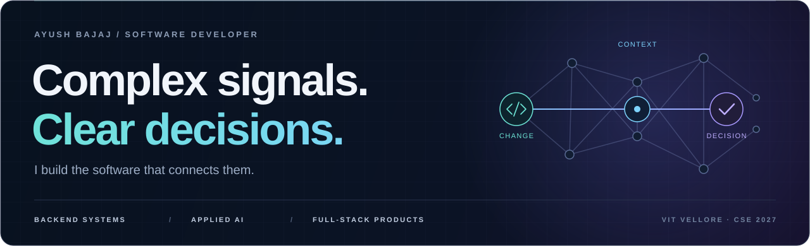

<picture>
  <source media="(max-width: 600px)" srcset="./assets/profile-banner-mobile.svg" />
  
</picture>

# Ayush Bajaj

**Software Developer · Backend Systems & Applied AI**

VIT Vellore · B.Tech Computer Science · Class of 2027

I build software that makes complex information useful — from understanding a code change's blast radius to keeping business records consistent.

[Selected work](#selected-work) · [Technical toolkit](#technical-toolkit) · [More projects](#more-projects) · [Experience](#experience--education)

## Selected work

### 01 / Microservice Drift Tracker

**A code change is local. Its consequences may not be.**

MDT connects Git diffs, AST analysis, service dependencies, and semantic context to estimate deployment impact across a microservice system.

**My contribution:** I built the **architectural smell detector** and **remediation simulator** in this ongoing team project. They help developers identify dependency problems and preview proposed changes in a Neo4j sandbox.

Code change → Dependency graph → Smell detection → Remediation preview

`Python` `FastAPI` `Neo4j` `ChromaDB` `Docker Compose` `React`

[Explore the shared repository ↗](https://github.com/kartick026/MDT) · [Read the smell detector](https://github.com/kartick026/MDT/blob/main/backend/services/smell_detector.py)

---

### 02 / Cat-X · Operator Shift Twin

**Make telemetry useful at the moment of a decision.**

An in-cab companion prototype combining shift tasks, proximity and safety signals, WebSocket telemetry, and consequence simulation to help compare possible operator actions.

**My contribution:** I built the **core prototype** as part of an ongoing college team project for the **Caterpillar Hackathon 2026**. The browser demo uses illustrative sample data.

Shift signals → Hazard checks → Consequence model → Operator decision

`Python` `FastAPI` `WebSockets` `React` `TypeScript`

[Try the sample-data demo ↗](https://cat-frontend-su80.onrender.com/shift) · [Explore the source](https://github.com/AyushBajaj7/Cat-X)

---

### 03 / Traders ERP

**One business action should leave every related record consistent.**

An ERP for hardware-trading workflows in Nepal, covering inventory, customer and supplier ledgers, billing, VCTS tracking, and cashbook.

**My contribution:** I built the platform **independently**. PostgreSQL functions coordinate bill creation, stock movements, and account balances atomically; the installable PWA supports offline-aware use.

Bill or purchase → Atomic database operation → Stock + ledger + cashbook

`Next.js` `TypeScript` `Supabase` `PostgreSQL` `PWA`

*Source is private.* [Project overview in my portfolio ↗](https://ayushbajaj7.github.io/Portfolio/)

---

### 04 / Document Summary Assistant

**A useful first read for documents that take time to unpack.**

A document workflow that accepts PDFs, Office files, spreadsheets, and scanned images, then combines Gemini and OCR to produce structured summaries, key points, and suggestions.

Document or scan → Text extraction / OCR → AI analysis → Structured summary

`Next.js` `TypeScript` `Gemini` `OCR` `Tailwind CSS`

[Try the app ↗](https://document-summary-assistant-beta.vercel.app/) · [Explore the source](https://github.com/AyushBajaj7/Document-summary-assistant)

## Technical toolkit

The tools behind the projects. **Click any badge to explore what the technology does.**

### Backend & data

   )     

### Applied AI & machine learning

)  )   

### Frontend engineering

)     

### Cloud, delivery & media

)     

## More projects

### AgriConnect

An agriculture platform bringing schemes, mandi prices, weather, farming tools, and an AI assistant into one interface. I contributed to the project; the linked demo requires sign-in and uses development storage.

`React` `Node.js` `Express` `MongoDB`

[Demo ↗](https://agri-connect-gamma-one.vercel.app/) · [Source](https://github.com/AyushBajaj7/AgriConnect)

### WeatherVision

Weather, air quality, precipitation trends, and city comparisons, backed by a **Python standard-library server**. A focused example of turning data into a readable interface.

`Python` `JavaScript` `Chart.js` `Weather APIs`

[Demo ↗](https://weathervision.onrender.com/) · [Source](https://github.com/AyushBajaj7/WeatherVision)

### Luxon

A commerce platform connecting product discovery, authentication, wishlists, cart and checkout, payment integration, and an admin portal for inventory and orders.

`Python` `Flask` `PostgreSQL` `Cloudinary` `Razorpay`

[Demo ↗](https://luxon-store.onrender.com/) · [Source](https://github.com/AyushBajaj7/Luxon)

### AI Presentation Explainer & Video Generator

A presentation-to-video pipeline connecting slide extraction, narration, speaker-avatar animation, and rendering. The local Flask implementation includes **retries, resumable processing, and a static-video fallback** when Wav2Lip is unavailable.

`Python` `Flask` `python-pptx` `pyttsx3` `Wav2Lip` `FFmpeg`

[Explore the source ↗](https://github.com/AyushBajaj7/Avatar-for-presentation-) · [Wav2Lip upstream](https://github.com/Rudrabha/Wav2Lip)

## Experience & education

**Software Developer Intern · KuppiSmart Solutions** 
May–Jul 2025

- Built responsive React interfaces and reusable components with Tailwind CSS.
- Integrated Razorpay payment processing through REST APIs and contributed feature releases.
- Automated build, test, and deployment workflows with GitHub Actions.

**B.Tech · Computer Science & Engineering · VIT Vellore** 
2023–2027 · CGPA: **8.76 / 10**

### Hackathons & competitions

Caterpillar CODE-A-THON 2026 · DevJams'24 (GDSC) · IEEE Yantra Central Hack · CodeChef CookOff 9.0

---

### Let's build something worth understanding.

Interested in **software engineering, backend systems, applied AI, and full-stack product work**.

[Portfolio](https://ayushbajaj7.github.io/Portfolio/) · [Resume](https://drive.google.com/file/d/1pNRl11o4bRue66-_wy4uAW5yQHv_iHgW/view) · [LinkedIn](https://www.linkedin.com/in/ayush-bajaj-3a8b28295/) · [ayushbajaj215@gmail.com](mailto:ayushbajaj215@gmail.com)

India & Kathmandu, Nepal

